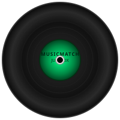

# 🎵 MusicMatch Jukebox Web & Tablet Edition

Uma recriação fiel, versátil e moderna do clássico **MusicMatch Jukebox** dos anos 90/2000 para rodar diretamente no navegador (PC e Tablets)!

## ✨ Principais Funcionalidades

- **Biblioteca com busca automática:**
  - Ao abrir, o servidor procura músicas nas pastas do usuário e nos discos locais/removíveis conectados ao computador onde ele está rodando.
  - A busca percorre subpastas, lê tags ID3 e adiciona as faixas encontradas à lista. Use **"🔍 Buscar músicas"** para atualizar a biblioteca.
  - Discos e pastas de rede não são varridos. Pastas sem permissão e diretórios de sistema são ignorados.
  - Músicas agrupadas por pasta, com recolhimento individual ou geral sem remover faixas da playlist.
  - Montagem, reordenação e salvamento de playlists personalizadas em `config.json`, compartilhadas entre PC e Tablet.

- **Edição Direta no Disco (Zero Duplicatas):**
  - O botão **"💾 Salvar no Arquivo"** sobrescreve o arquivo original no mesmo lugar onde ele está no computador.
  - Gravação dupla de tags: **ID3v2.3 (UTF-16 com BOM)** e **ID3v1.1 (128 bytes)**.
  - Suporte completo a Capas de Álbum (*Cover Art*).

- **Player Completo estilo MusicMatch:**
  - Painel LCD com display digital retro, título deslizante (*marquee ticker*), medidor de bitrate e tempo (decorrido/restante).
  - Controles clássicos: Play, Pause, Stop, Anterior, Próxima, Shuffle e Repeat.
  - Controle de Balanço Estéreo (Esq / Dir) e Volume mestre.

- **Visualizador de Espectro em Tempo Real (Web Audio API):**
  - Barrinhas de LED com gradiente verde/amarelo/vermelho e picos flutuantes (*peak hold*).
  - 3 modos de visualização: **Bars** (espectro), **Wave** (osciloscópio) e **VU** (medidores analógicos estéreo).

- **Equalizador Gráfico de 10 Bandas & Preamp:**
  - Frequências de 31Hz a 16kHz (+12dB / -12dB).
  - Presets: Flat, Rock, Pop, Jazz, Bass Boost, Vocal e Techno.

---

## 📱 Como Acessar no Tablet pelo navegador

1. Certifique-se de que o tablet e o PC estejam na mesma rede Wi-Fi.
2. No navegador do Tablet, acesse:
   👉 **`http://IP_DO_PC:8081`** (substitua pelo IPv4 atual do PC)
3. As músicas dos discos locais do PC onde o servidor está rodando aparecerão automaticamente. Você pode tocar, gerenciar playlists e editar tags direto da tela de toque do tablet.
   - Por segurança, navegadores não permitem varrer automaticamente o armazenamento do próprio tablet. Para tocar arquivos do tablet, use **"➕ Arquivos"** ou **"📁 Pasta Local"**.

## 📲 Aplicativo Android (APK)

O APK é independente: inclui a interface do player, busca músicas no armazenamento do próprio tablet e reproduz os arquivos localmente. Não precisa do servidor Python, Wi-Fi ou computador.

1. Instale `android-app/app/build/outputs/apk/debug/app-debug.apk` no tablet.
2. Autorize o acesso a arquivos de áudio quando solicitado.
3. Abra **Buscar músicas** para atualizar a biblioteca local.
4. Ao selecionar o modo **VU**, autorize o acesso ao áudio para sincronizar os medidores com a reprodução. Essa captura usa o sinal do player, não o microfone; se a permissão for negada, o player continua funcionando com a animação visual.

Para gerar o APK de depuração, instale Node.js/npm e execute `npm ci` na pasta do projeto. Depois, abra `android-app` no Android Studio com JDK 17 e SDK Android 35, ou execute `gradlew.bat assembleDebug` nessa pasta. Os scripts do player são transpilados para compatibilidade com WebViews antigos do Android.

---

---

## 🪟 Rodando o Jukebox diretamente no Windows

Se você quiser levar o projeto para rodar no Windows:

1. Instale o Python ([python.org](https://www.python.org/)) marcando a opção **"Add Python to PATH"**.
2. Copie a pasta `musicmatch-jukebox` para o seu computador Windows.
3. Ao iniciar o servidor, a biblioteca será preenchida automaticamente com músicas encontradas nos discos locais e removíveis.
   - O `config.json` é criado automaticamente e não é versionado no Git, pois contém suas playlists.
4. Arquivos de inicialização inclusos:
   - **`iniciar.bat`**: Inicia o servidor em segundo plano (silencioso, sem janela preta) e abre a página no navegador com 2 cliques.
   - **`parar.bat`**: Encerra o servidor na porta 8081.
   - **`iniciar_com_janela.bat`**: Inicia mostrando a janela do terminal com logs detalhados de streaming e gravação.
5. Para iniciar automaticamente ao ligar o Windows:
   - Pressione `Win + R`, digite `shell:startup` e crie um atalho para o `iniciar.bat` lá dentro.

# MUSICMATCH-JUKEBOX
